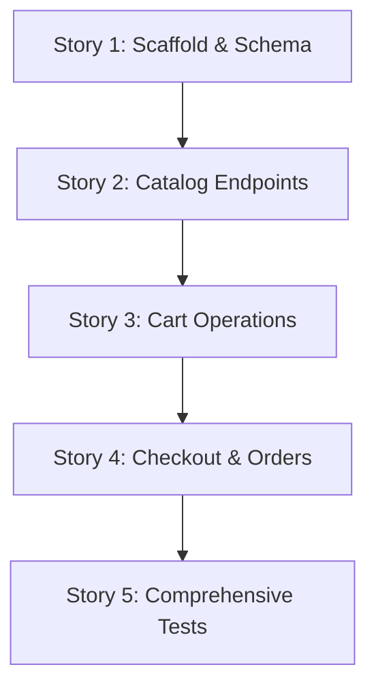

# Breakdown — PER-129

**Feature:** Build the BookNest bookstore API from an empty repo  
**Epic:** PER-129  
**Last updated:** 2025-06-10

---

## Overview

This breakdown implements the complete BookNest API from an empty repository. The first story creates the project scaffold, schema, and health check. Subsequent stories add catalog endpoints, cart operations, checkout with stock validation, order shipping, and comprehensive tests. Each story is independently testable and builds on prior infrastructure.

---

## Story Dependencies and Order

The stories below must be implemented in the listed order. Each story depends on all prior stories being complete and merged.



---

## Stories

### Story 1: Project scaffold, database schema, and health check

**Repo:** `Book`

**Description:**  
Set up the Node.js project from scratch with Express, better-sqlite3, and Jest. Create the database module that initializes the SQLite schema (product, cart, cart_item, order, order_item tables with foreign keys). Create the Express app with a health check endpoint. Create the server entry point that binds to port 3000 and initializes the database on startup. Provide npm scripts for start and test.

**Covers requirements:**  
- REQ-1: Project structure and dependencies
- REQ-2: Database schema
- REQ-9: Health check

**Covers acceptance criteria:**  
- AC-1: Fresh clone → npm install, npm start → API on port 3000, data/booknest.sqlite created with tables
- AC-2: GET /api/health → 200 { "status": "ok" }

**Allowed paths:**  
```
package.json
src/server.js
src/app.js
src/db.js
src/routes/health.js
data/.gitkeep
.gitignore
```

**Verification approach:**  
1. Run `npm install` in fresh clone → succeeds, no errors
2. Run `npm start` → server listens on port 3000, logs "Server listening on port 3000"
3. Check `data/booknest.sqlite` file exists
4. Open SQLite file, verify tables exist: `product`, `cart`, `cart_item`, `order`, `order_item`
5. Query `PRAGMA foreign_keys` → returns 1 (enabled)
6. Query each table's schema → matches CREATE TABLE statements in HLD
7. GET http://localhost:3000/api/health → 200 { "status": "ok" }
8. Stop server, restart → health check still works, tables still present
9. Run `npm test` → passes (health check test only at this stage)

**Test count:** 3 tests (AC-1 server startup + schema creation, AC-2 health check response, AC-14 persistence across restart)

**Dependencies:**  
None (first story)

**Open questions:**  
None

**Notes:**  
- The `.gitignore` file should exclude `node_modules/` and `data/*.sqlite`.
- The `data/.gitkeep` ensures the `data/` directory is tracked in git but the SQLite file is not.
- The database module (`src/db.js`) exports both the database instance and an `initDb()` function that creates tables.
- The server entry point (`src/server.js`) calls `initDb()` before `app.listen()`.

---

### Story 2: Catalog endpoints with role-based access control

**Repo:** `Book`

**Description:**  
Create the role middleware that reads the `x-role` header and provides an `requireAdmin` guard. Implement the books route with POST (admin only), GET list, and GET by ID. Validate book creation input (title, author, price > 0, stock ≥ 0). Return 403 when a shopper tries to POST, 400 for validation failures, 404 for missing books.

**Covers requirements:**  
- REQ-3: Role-based access control
- REQ-4: Catalog endpoints
- REQ-10: Error handling (validation, auth, not-found)

**Covers acceptance criteria:**  
- AC-3: Admin POST /api/books → 201 with created book, GET /api/books/:id returns it
- AC-4: Shopper POST /api/books → 403
- AC-5: Shopper GET /api/books → 200 with array of books (title, author, price, stock)

**Allowed paths:**  
```
src/middleware/role.js
src/routes/books.js
__tests__/books.test.js
```

**Verification approach:**  
1. POST /api/books with `x-role: admin`, valid book → 201, response includes id, title, author, price, stock
2. GET /api/books/:id for created book → 200, same fields
3. POST /api/books with `x-role: shopper` → 403 { "error": "Admin role required" }
4. POST /api/books with no x-role header → 403
5. POST /api/books with empty title → 400 { "error": "<validation message>" }
6. POST /api/books with price = 0 → 400
7. POST /api/books with stock = -1 → 400
8. GET /api/books → 200, array includes all created books
9. GET /api/books with no books → 200, empty array
10. GET /api/books/999 (nonexistent) → 404 { "error": "Book not found" }
11. Create 3 books, GET /api/books → 200, array length 3, all fields present

**Test count:** 11 tests (AC-3 admin create + retrieve, AC-4 shopper 403, AC-5 list books, validation cases, not-found case)

**Dependencies:**  
- Story 1 (database schema, server scaffold)

**Open questions:**  
None

**Notes:**  
- The role middleware attaches `req.role` from `req.headers["x-role"]`.
- The `requireAdmin` middleware checks `req.role === "admin"` and returns 403 otherwise.
- Validation is in the route handler, not database constraints.
- Price and stock are stored as REAL and INTEGER in SQLite; ensure JavaScript number validation matches.

---

### Story 3: Cart operations with stock validation

**Repo:** `Book`

**Description:**  
Implement the cart route with POST /api/cart/items (creates cart if `x-cart-id` missing, upserts cart_item with stock validation), GET /api/cart (joins cart_item with product to show line totals), and DELETE /api/cart/items/:bookId. Validate that adding to cart does not exceed stock (considering existing cart quantity for that book). Return cart ID in POST response when cart is created.

**Covers requirements:**  
- REQ-5: Cart identification and management
- REQ-6: Cart item operations
- REQ-10: Error handling (validation, cart ID required)

**Covers acceptance criteria:**  
- AC-6: Shopper adds book to new cart → 201 with cart ID, GET /api/cart shows line with price and line total
- AC-7: Add same book again → quantity increments
- AC-8: Add quantity > stock → 400, cart unchanged
- AC-9: DELETE /api/cart/items/:bookId → line removed

**Allowed paths:**  
```
src/routes/cart.js
__tests__/cart.test.js
```

**Verification approach:**  
1. Create book with stock 5 (admin POST /api/books)
2. POST /api/cart/items with no x-cart-id, quantity 2 → 201, response includes cartId
3. GET /api/cart with that cartId → 200, items array length 1, quantity 2, lineTotal = price × 2
4. POST /api/cart/items with same cartId, same bookId, quantity 1 → 201
5. GET /api/cart → quantity now 3, lineTotal = price × 3
6. POST /api/cart/items with quantity 3 (total would be 6 > stock 5) → 400 { "error": "..." }, cart unchanged
7. GET /api/cart → still quantity 3
8. POST /api/cart/items with quantity 10 in fresh cart → 400, no cart created
9. DELETE /api/cart/items/:bookId with cartId → 200
10. GET /api/cart → items array empty
11. POST /api/cart/items without x-cart-id header → 201, creates new cart, returns different cartId
12. GET /api/cart with no x-cart-id header → 400 { "error": "Cart ID required" }
13. GET /api/cart with nonexistent cartId → 404 { "error": "Cart not found" }
14. DELETE /api/cart/items/:bookId for nonexistent book → 404 { "error": "Item not found in cart" }

**Test count:** 14 tests (AC-6 new cart + line total, AC-7 increment, AC-8 stock validation, AC-9 remove, edge cases)

**Dependencies:**  
- Story 1 (database schema)
- Story 2 (books endpoints to create test data)

**Open questions:**  
None

**Notes:**  
- When `x-cart-id` is missing on POST, create a cart row, then insert cart_item, then return the cart ID.
- When `x-cart-id` is present, validate it exists, else return 404.
- Stock validation: `SELECT stock FROM product WHERE id = bookId`, then check existing cart quantity + request quantity ≤ stock.
- If book already in cart, use `INSERT OR REPLACE INTO cart_item` or manual SELECT + UPDATE logic (better-sqlite3 supports both).
- Line total calculation: `quantity * price` from current product.price.

---

### Story 4: Checkout with stock reduction and order shipping

**Repo:** `Book`

**Description:**  
Implement POST /api/checkout (validates cart quantities against stock in a transaction, creates order and order_items, reduces stock, empties cart). Implement POST /api/orders/:id/ship (admin only, updates order status to "shipped"). Ensure checkout transaction rolls back on stock validation failure and that order_item captures price at checkout time.

**Covers requirements:**  
- REQ-7: Checkout and order creation
- REQ-8: Order shipping
- REQ-10: Error handling (validation, auth)

**Covers acceptance criteria:**  
- AC-10: Checkout with valid cart → 201 order with status "placed", same lines, total; cart empty, stock reduced
- AC-11: Checkout with quantity > stock → 400, no order, stock unchanged
- AC-12: Admin ship order → status "shipped"
- AC-13: Shopper ship order → 403

**Allowed paths:**  
```
src/routes/checkout.js
src/routes/orders.js
__tests__/checkout.test.js
__tests__/orders.test.js
```

**Verification approach:**  
1. Create book with stock 5, add to cart quantity 2, checkout → 201 with order id, status "placed", items array, total
2. GET /api/cart for that cart → empty items array
3. GET /api/books/:id → stock now 3 (5 - 2)
4. Query order_item table → quantity 2, price matches book price at checkout time
5. Create cart with quantity 6 (> stock 3), checkout → 400 { "error": "..." }
6. GET /api/books/:id → stock still 3 (unchanged)
7. Query order table → no new order row created
8. Checkout with empty cart → 400 { "error": "..." }
9. POST /api/orders/:orderId/ship with x-role: admin → 200, order status "shipped"
10. Query order table → status = "shipped"
11. POST /api/orders/:orderId/ship with x-role: shopper → 403 { "error": "Admin role required" }
12. POST /api/orders/999/ship with x-role: admin → 404 { "error": "Order not found" }
13. Create cart with 2 books, quantities in stock, checkout → order has 2 order_item rows, both stocks reduced
14. Restart server, query order and stock → data persists (touches AC-14)

**Test count:** 14 tests (AC-10 successful checkout + cart empty + stock reduction, AC-11 validation failure, AC-12 admin ship, AC-13 shopper 403, edge cases, multi-item checkout, persistence)

**Dependencies:**  
- Story 1 (database schema)
- Story 2 (books endpoints, role middleware)
- Story 3 (cart operations)

**Open questions:**  
None

**Notes:**  
- Use `db.transaction(() => { ... })` in checkout route to wrap all operations.
- Validation loop: SELECT cart_item JOIN product WHERE cart_id = ?, check every quantity ≤ stock, reject if any fails before any writes.
- Calculate total as sum of (quantity × price) for all lines.
- INSERT order row, INSERT order_item rows (copying book_id, quantity, current price), UPDATE product stock, DELETE cart_item rows.
- Order shipping: simple UPDATE order SET status = 'shipped' WHERE id = :id, return 404 if no rows affected.

---

### Story 5: Comprehensive test coverage for all acceptance criteria

**Repo:** `Book`

**Description:**  
Write the complete Jest test suite covering health check, catalog auth enforcement, cart operations (add/update/delete), checkout with stock validation, shipping with role enforcement, and data persistence across server restarts. Ensure every acceptance criterion has at least one corresponding test case and every validation/error path is tested. Use supertest to call the API and better-sqlite3 to inspect database state.

**Covers requirements:**  
- REQ-11: Data persistence
- REQ-12: Test coverage

**Covers acceptance criteria:**  
- AC-14: Data persists across restart (books, orders, reduced stock)
- AC-15: npm test passes all tests covering health, catalog auth, cart, checkout, stock, shipping

**Allowed paths:**  
```
__tests__/health.test.js (already created in Story 1, extend if needed)
__tests__/books.test.js (already created in Story 2, extend if needed)
__tests__/cart.test.js (already created in Story 3, extend if needed)
__tests__/checkout.test.js (already created in Story 4, extend if needed)
__tests__/orders.test.js (already created in Story 4, extend if needed)
__tests__/persistence.test.js (new)
```

**Verification approach:**  
1. Run `npm test` → all tests pass
2. Count test cases: health (3 from Story 1), books (11 from Story 2), cart (14 from Story 3), checkout+orders (14 from Story 4), persistence (new: 5) → total ≥ 47 tests
3. Persistence tests:
   a. Create book, restart server (stop and start in test), GET /api/books/:id → book still exists
   b. Create cart with item, restart, GET /api/cart → cart still exists (though typically cart would be ephemeral; this tests schema persistence)
   c. Create order, restart, query order table → order still exists
   d. Create book stock 10, order quantity 3, restart, GET /api/books/:id → stock 7 persists
   e. Ship order, restart, query order → status "shipped" persists
4. Ensure test isolation: each test file uses `beforeEach` to reset database (drop tables, recreate schema) or use a test-specific database file
5. Check coverage of all ACs: AC-1 through AC-15 each have at least one test verifying the expected behavior
6. Check coverage of error paths: 403 admin role, 400 validation, 404 not found, all covered in tests
7. Run tests multiple times → consistent pass

**Test count:** 5 new persistence tests (AC-14 book persistence, cart persistence, order persistence, stock persistence, status persistence) + AC-15 meta-test that npm test passes

**Dependencies:**  
- Story 1 (health tests baseline)
- Story 2 (books tests baseline)
- Story 3 (cart tests baseline)
- Story 4 (checkout and orders tests baseline)

**Open questions:**  
None

**Notes:**  
- The persistence tests in `__tests__/persistence.test.js` will programmatically stop and restart the server within the test (or use `beforeEach`/`afterEach` hooks to close and reopen the database connection).
- Alternatively, persistence can be tested by inspecting the SQLite file directly after server shutdown (using a separate better-sqlite3 connection in the test).
- Test isolation strategy: use a test-specific database file (e.g. `data/booknest.test.sqlite`) that is deleted and recreated in `beforeEach`, or run `DROP TABLE IF EXISTS` for all tables before each test.
- Ensure `package.json` test script is `jest` with no watch mode, so `npm test` runs once and exits.
- Total test count across all stories: 3 + 11 + 14 + 14 + 5 = 47 tests minimum.

---

## Summary

| Story | Title | Test Count | Dependencies |
|---|---|---|---|
| 1 | Project scaffold, database schema, and health check | 3 | None |
| 2 | Catalog endpoints with role-based access control | 11 | Story 1 |
| 3 | Cart operations with stock validation | 14 | Stories 1, 2 |
| 4 | Checkout with stock reduction and order shipping | 14 | Stories 1, 2, 3 |
| 5 | Comprehensive test coverage for all acceptance criteria | 5 | Stories 1, 2, 3, 4 |
| **Total** | | **47** | |

---

## Acceptance Criteria Coverage

All 15 acceptance criteria from the ticket are covered across the 5 stories:

- **AC-1** (scaffold + schema): Story 1
- **AC-2** (health check): Story 1
- **AC-3** (admin add book): Story 2
- **AC-4** (shopper 403 on add book): Story 2
- **AC-5** (list books): Story 2
- **AC-6** (add to cart, new cart): Story 3
- **AC-7** (increment cart quantity): Story 3
- **AC-8** (reject quantity > stock): Story 3
- **AC-9** (remove cart item): Story 3
- **AC-10** (checkout success): Story 4
- **AC-11** (checkout fail on stock): Story 4
- **AC-12** (admin ship order): Story 4
- **AC-13** (shopper 403 on ship): Story 4
- **AC-14** (persistence across restart): Story 1 (initial), Story 5 (comprehensive)
- **AC-15** (test coverage): Story 5 (meta-test), all stories contribute tests

---

## Requirements Coverage

All 12 requirements from requirements.md are covered:

- **REQ-1** (project structure): Story 1
- **REQ-2** (database schema): Story 1
- **REQ-3** (role-based access): Story 2
- **REQ-4** (catalog endpoints): Story 2
- **REQ-5** (cart identification): Story 3
- **REQ-6** (cart item operations): Story 3
- **REQ-7** (checkout): Story 4
- **REQ-8** (order shipping): Story 4
- **REQ-9** (health check): Story 1
- **REQ-10** (error handling): Stories 2, 3, 4
- **REQ-11** (data persistence): Story 5
- **REQ-12** (test coverage): Story 5

---

## Open Questions

None. All acceptance criteria and requirements are fully covered by the five stories in the breakdown.

---

## Notes

- **Story ordering rationale:** Story 1 creates the foundation (scaffold, schema, health). Story 2 adds catalog and auth (needed for test data in later stories). Story 3 adds cart (depends on books existing). Story 4 adds checkout and shipping (depends on cart). Story 5 consolidates and extends tests (depends on all features existing).
- **Independent testability:** Each story's verification approach can run in isolation by seeding prerequisite data (e.g. Story 3 tests create books first using admin POST from Story 2).
- **Concrete paths:** All file paths are listed under "Allowed paths" for each story and match the repo-tree structure (`/home/pavc/Documents/Book-Nest-Product/`).
- **Test count consistency:** The total test count (47) is the sum of verification test counts across all stories. This count is the minimum; additional edge case tests may be added during implementation. The LLD and final test files must match or exceed this count.
- **No new ACs:** All acceptance criteria are copied verbatim from the ticket and requirements.md. Clarifications (e.g. "quantity > stock" edge cases) are marked as such in verification approaches, not added as new epic ACs.
- **Repo consistency:** All stories are scoped to the `Book` repo, matching the project-context.
