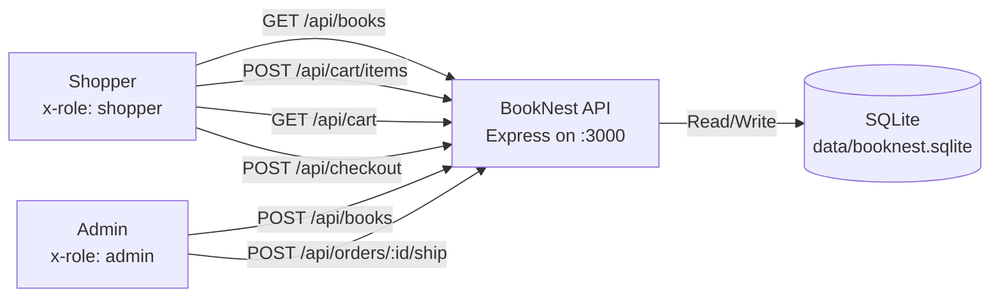
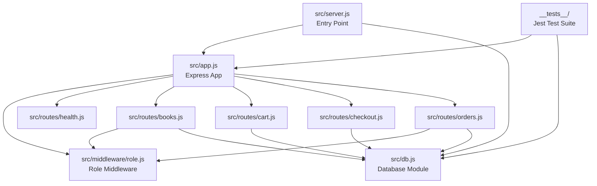
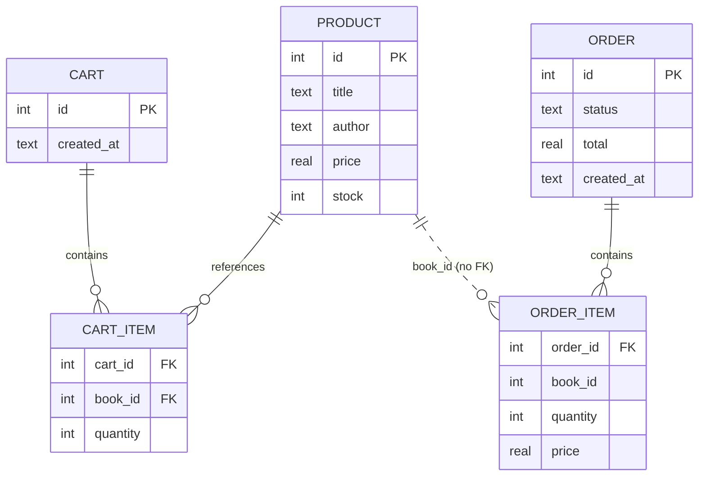
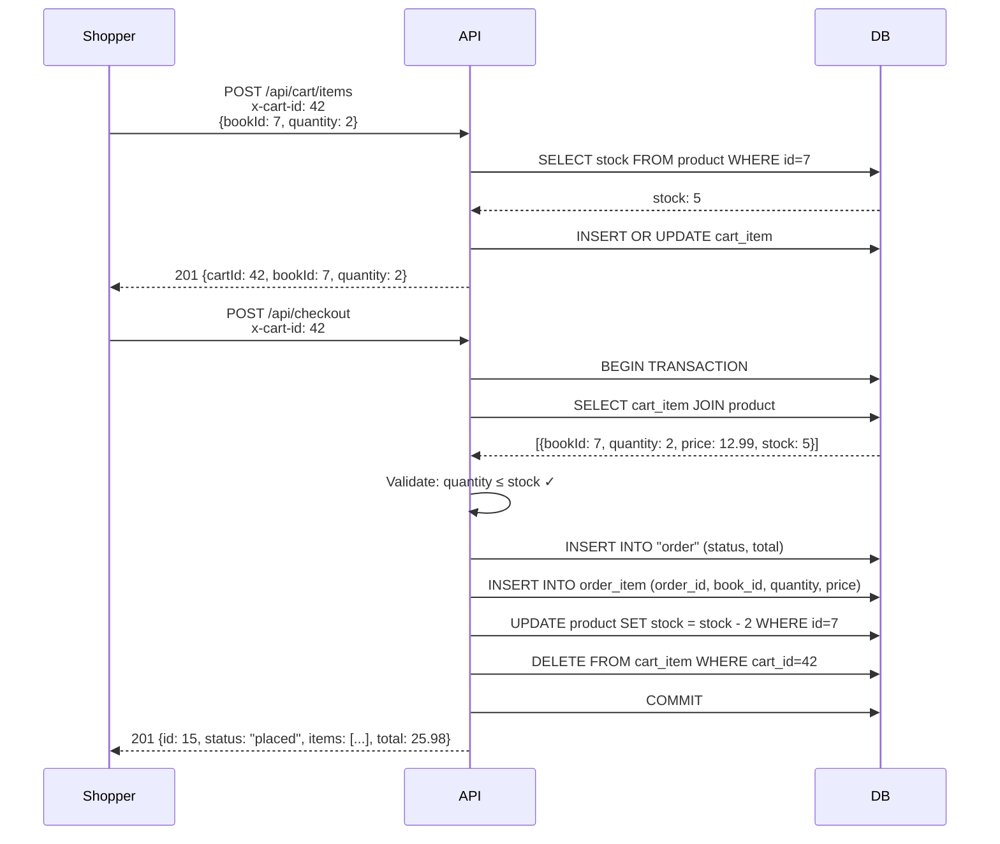

# High-Level Design — PER-129

**Feature:** Build the BookNest bookstore API from an empty repo  
**Repo:** Book  
**Last updated:** 2025-06-10  
**Altitude:** Feature

---

## Overview

BookNest is a single-shop bookstore HTTP API serving JSON over Express, backed by SQLite. A shopper browses books, manages a cart identified by header, and places orders that reduce stock. An admin adds books and marks orders shipped. Role enforcement uses the `x-role` header; no sessions or passwords exist. The entire application is built from an empty repository in one feature.

---

## Architecture Decisions

### AD-1: Single-process Express API with synchronous SQLite
**Binds:** All HTTP logic runs in one Node.js process using Express; all database operations use better-sqlite3 synchronous API.  
**Prevents:** Drift into async/await database patterns, external queue systems, or microservices.  
**Rule:** Every route handler calls synchronous `db.prepare(...).run()` or `.get()` or `.all()`. No ORM. No connection pooling. No Redis or external cache.  
**Status:** `[ADOPTED]` — repo-context mandates Express and better-sqlite3; the acceptance criteria describe synchronous startup and single-port operation.

### AD-2: Role-based access via `x-role` header
**Binds:** Authorization reads `x-role` from request headers; valid values are `admin` and `shopper`. Routes requiring admin role return 403 when `x-role !== "admin"`. No other authentication mechanism exists.  
**Prevents:** Drift into session cookies, JWT tokens, or user account tables.  
**Rule:** Middleware reads `req.headers["x-role"]`. POST `/api/books` and POST `/api/orders/:id/ship` require `x-role: admin`; all other routes allow any role or no role. Return 403 with `{ "error": "<message>" }` when role check fails.  
**Status:** `[ADOPTED]` — requirements REQ-3, AC-4, AC-12, AC-13.

### AD-3: Cart identification via `x-cart-id` header
**Binds:** A cart is identified by an integer ID passed in the `x-cart-id` header. If the header is missing on POST `/api/cart/items`, create a new cart row and return the cart ID in the response. If present, use that cart.  
**Prevents:** Drift into session-based cart storage, cookie-based cart tracking, or user-account-linked carts.  
**Rule:** POST `/api/cart/items` without `x-cart-id` → `INSERT INTO cart` → return `{ "cartId": <id>, ... }`. All other cart operations require `x-cart-id` and use it in WHERE clauses. No cart ownership or shopper-to-cart mapping exists.  
**Status:** `[ADOPTED]` — requirements REQ-5, AC-6.

### AD-4: Checkout atomically converts cart to order and reduces stock
**Binds:** POST `/api/checkout` validates all cart item quantities against current stock, creates an order with status `"placed"`, copies cart items to order items, reduces each book's stock by the ordered quantity, and empties the cart — all in one transaction.  
**Prevents:** Stock oversell, partial checkouts, or cart persistence after order creation.  
**Rule:** Use `db.transaction(() => { ... })` wrapping: stock validation loop (SELECT stock WHERE id IN cart book IDs, reject if any quantity > stock), INSERT order, INSERT order_item rows, UPDATE product SET stock = stock - quantity for each line, DELETE cart_item WHERE cart_id = ?. Return 400 if validation fails before any writes. Return 201 with order object on success.  
**Status:** `[ADOPTED]` — requirements REQ-7, AC-10, AC-11.

### AD-5: SQLite schema with foreign keys and composite keys
**Binds:** Five tables: `product` (id, title, author, price, stock), `cart` (id, created_at), `cart_item` (cart_id, book_id, quantity, PRIMARY KEY (cart_id, book_id), FOREIGN KEY cart_id, book_id), `order` (id, status, total, created_at), `order_item` (order_id, book_id, quantity, price, PRIMARY KEY (order_id, book_id), FOREIGN KEY order_id). Schema created on startup if tables missing.  
**Prevents:** Duplicate cart lines, orphaned cart items, or schema drift across restarts.  
**Rule:** `cart_item` and `order_item` use composite primary keys to enforce one row per (cart, book) or (order, book). Foreign keys reference `cart.id`, `product.id`, `order.id`. Run CREATE TABLE IF NOT EXISTS on server startup in `src/db.js`. Enable foreign keys with `PRAGMA foreign_keys = ON`.  
**Status:** `[ADOPTED]` — requirements REQ-2, AC-1.

### AD-6: Error responses as JSON with appropriate HTTP status
**Binds:** All validation failures return 400, authorization failures return 403, not-found cases return 404, internal errors return 500. Body is always `{ "error": "<descriptive message>" }`.  
**Prevents:** Inconsistent error formats, status code drift, or HTML error pages.  
**Rule:** Middleware or route handler catches errors and responds with `res.status(code).json({ error: message })`. Validation errors (stock exceeded, missing fields) → 400. Role check fails → 403. Resource not found → 404. Uncaught exceptions → 500.  
**Status:** `[ADOPTED]` — requirements REQ-10.

---

## System Structure

### Components

#### 1. HTTP Server (`src/server.js`)
- **Responsibility:** Start Express app, bind to `PORT` (default 3000), initialize database on startup.
- **Dependencies:** Express, `src/app.js`, `src/db.js`.
- **Contracts:** Exports nothing (entry point). Calls `initDb()` before `app.listen()`.

#### 2. Express Application (`src/app.js`)
- **Responsibility:** Define all routes, apply middleware (JSON body parser, role reader), export the configured Express app.
- **Dependencies:** Express, route modules (`src/routes/health.js`, `src/routes/books.js`, `src/routes/cart.js`, `src/routes/checkout.js`, `src/routes/orders.js`).
- **Contracts:** Exports `app` (Express instance). Mounts routes under `/api`. Returns JSON for all responses.

#### 3. Database Module (`src/db.js`)
- **Responsibility:** Open SQLite connection, create schema, export database instance and `initDb()` function.
- **Dependencies:** better-sqlite3.
- **Contracts:** Exports `db` (Database instance) and `initDb()` (runs CREATE TABLE IF NOT EXISTS for all five tables, enables foreign keys). File path: `data/booknest.sqlite`.

#### 4. Role Middleware (`src/middleware/role.js`)
- **Responsibility:** Read `x-role` header, attach to `req.role`. Provide `requireAdmin` middleware that returns 403 if `req.role !== "admin"`.
- **Dependencies:** None.
- **Contracts:** `roleReader(req, res, next)` sets `req.role = req.headers["x-role"] || null`. `requireAdmin(req, res, next)` checks `req.role === "admin"`, else `res.status(403).json({ error: "Admin role required" })`.

#### 5. Health Route (`src/routes/health.js`)
- **Responsibility:** GET `/api/health` → `{ "status": "ok" }`.
- **Dependencies:** Express Router.
- **Contracts:** Exports router. Single route: `GET /` returns 200 with JSON body.

#### 6. Books Route (`src/routes/books.js`)
- **Responsibility:** Catalog operations: POST (admin only), GET list, GET by ID.
- **Dependencies:** Express Router, `src/db.js`, `src/middleware/role.js`.
- **Contracts:** Exports router. POST `/` requires `requireAdmin`, validates `{ title, author, price, stock }`, inserts into `product`, returns 201 with created book. GET `/` returns 200 with array of all books. GET `/:id` returns 200 with single book or 404.

#### 7. Cart Route (`src/routes/cart.js`)
- **Responsibility:** Add item to cart, get cart contents, remove item.
- **Dependencies:** Express Router, `src/db.js`.
- **Contracts:** Exports router. POST `/items` reads `x-cart-id` header, creates cart if missing, validates stock, upserts `cart_item`, returns 201 with `cartId`. GET `/` reads `x-cart-id`, joins `cart_item` and `product`, returns 200 with items array and line totals. DELETE `/items/:bookId` reads `x-cart-id`, deletes `cart_item` row, returns 200.

#### 8. Checkout Route (`src/routes/checkout.js`)
- **Responsibility:** Convert cart to order, reduce stock, empty cart.
- **Dependencies:** Express Router, `src/db.js`.
- **Contracts:** Exports router. POST `/` reads `x-cart-id`, validates all cart item quantities ≤ stock in a transaction, creates `order` and `order_item` rows, updates `product.stock`, deletes `cart_item` rows, returns 201 with order object containing `id`, `status`, `items`, `total`.

#### 9. Orders Route (`src/routes/orders.js`)
- **Responsibility:** Ship order (admin only).
- **Dependencies:** Express Router, `src/db.js`, `src/middleware/role.js`.
- **Contracts:** Exports router. POST `/:id/ship` requires `requireAdmin`, updates `order.status` to `"shipped"`, returns 200 with updated order or 404 if order not found.

#### 10. Test Suite (`__tests__/`)
- **Responsibility:** Cover all acceptance criteria with Jest tests.
- **Dependencies:** Jest, supertest, `src/app.js`, `src/db.js`.
- **Contracts:** Tests in `__tests__/health.test.js`, `__tests__/books.test.js`, `__tests__/cart.test.js`, `__tests__/checkout.test.js`, `__tests__/orders.test.js`, `__tests__/persistence.test.js`. Each file uses `beforeEach` to reset database state (drop and recreate tables). Tests call `request(app).get(...).set("x-role", ...)` and assert status and body.

---

## Data Model

### Tables and Constraints

#### `product`
```sql
CREATE TABLE IF NOT EXISTS product (
  id INTEGER PRIMARY KEY AUTOINCREMENT,
  title TEXT NOT NULL,
  author TEXT NOT NULL,
  price REAL NOT NULL,
  stock INTEGER NOT NULL DEFAULT 0
);
```
- **Constraints:** `title`, `author`, `price`, `stock` are all required. `stock` must be non-negative (enforced in application logic).

#### `cart`
```sql
CREATE TABLE IF NOT EXISTS cart (
  id INTEGER PRIMARY KEY AUTOINCREMENT,
  created_at TEXT NOT NULL DEFAULT CURRENT_TIMESTAMP
);
```
- **Constraints:** `created_at` defaults to current timestamp.

#### `cart_item`
```sql
CREATE TABLE IF NOT EXISTS cart_item (
  cart_id INTEGER NOT NULL,
  book_id INTEGER NOT NULL,
  quantity INTEGER NOT NULL,
  PRIMARY KEY (cart_id, book_id),
  FOREIGN KEY (cart_id) REFERENCES cart(id) ON DELETE CASCADE,
  FOREIGN KEY (book_id) REFERENCES product(id) ON DELETE CASCADE
);
```
- **Constraints:** Composite primary key prevents duplicate (cart, book) rows. `quantity` must be positive (enforced in application logic). Foreign keys cascade deletes.

#### `order`
```sql
CREATE TABLE IF NOT EXISTS "order" (
  id INTEGER PRIMARY KEY AUTOINCREMENT,
  status TEXT NOT NULL DEFAULT 'placed',
  total REAL NOT NULL,
  created_at TEXT NOT NULL DEFAULT CURRENT_TIMESTAMP
);
```
- **Constraints:** `status` defaults to `"placed"`. `total` is calculated on checkout. Table name `"order"` is quoted because `order` is a SQL keyword.

#### `order_item`
```sql
CREATE TABLE IF NOT EXISTS order_item (
  order_id INTEGER NOT NULL,
  book_id INTEGER NOT NULL,
  quantity INTEGER NOT NULL,
  price REAL NOT NULL,
  PRIMARY KEY (order_id, book_id),
  FOREIGN KEY (order_id) REFERENCES "order"(id) ON DELETE CASCADE
);
```
- **Constraints:** Composite primary key prevents duplicate (order, book) rows. `price` is the price at order time (not a foreign key to `product.price`). `book_id` is stored as an integer but not a foreign key (allows orders to persist even if a book is deleted from the catalog). `quantity` and `price` are always positive.

---

## API Contracts

All routes return JSON. All validation errors return 400 with `{ "error": "<message>" }`. All authorization errors return 403. All not-found errors return 404. All internal errors return 500.

### Health Check

#### `GET /api/health`
**Request:**
- Headers: None required.
- Body: None.

**Response:**
- Status: 200
- Body: `{ "status": "ok" }`

---

### Catalog Operations

#### `POST /api/books` (Admin only)
**Request:**
- Headers: `x-role: admin` (required)
- Body: `{ "title": "<string>", "author": "<string>", "price": <number>, "stock": <number> }`

**Response:**
- Status: 201 on success, 403 if role is not admin, 400 if validation fails
- Body (201): `{ "id": <number>, "title": "<string>", "author": "<string>", "price": <number>, "stock": <number> }`
- Body (403): `{ "error": "Admin role required" }`
- Body (400): `{ "error": "<validation message>" }`

**Validation:**
- `title`, `author` must be non-empty strings.
- `price` must be a positive number.
- `stock` must be a non-negative integer.

#### `GET /api/books`
**Request:**
- Headers: None required.
- Body: None.

**Response:**
- Status: 200
- Body: `[{ "id": <number>, "title": "<string>", "author": "<string>", "price": <number>, "stock": <number> }, ...]`

#### `GET /api/books/:id`
**Request:**
- Headers: None required.
- Body: None.

**Response:**
- Status: 200 on success, 404 if book not found
- Body (200): `{ "id": <number>, "title": "<string>", "author": "<string>", "price": <number>, "stock": <number> }`
- Body (404): `{ "error": "Book not found" }`

---

### Cart Operations

#### `POST /api/cart/items`
**Request:**
- Headers: `x-cart-id: <number>` (optional; if missing, a new cart is created)
- Body: `{ "bookId": <number>, "quantity": <number> }`

**Response:**
- Status: 201 on success, 400 if validation fails, 404 if book not found
- Body (201): `{ "cartId": <number>, "bookId": <number>, "quantity": <number> }`
- Body (400): `{ "error": "<validation message>" }` (e.g. quantity exceeds stock, quantity is not positive)
- Body (404): `{ "error": "Book not found" }`

**Validation:**
- `bookId` must exist in `product` table.
- `quantity` must be a positive integer.
- `quantity` must not exceed `product.stock` (after considering any existing quantity in the cart for that book).

**Behavior:**
- If `x-cart-id` is missing, insert a new `cart` row and use that ID.
- If the book is already in the cart, increment `cart_item.quantity` by the request quantity (still validating against stock).
- If the book is not in the cart, insert a new `cart_item` row.

#### `GET /api/cart`
**Request:**
- Headers: `x-cart-id: <number>` (required)
- Body: None.

**Response:**
- Status: 200 on success, 400 if `x-cart-id` is missing or invalid
- Body (200): `{ "cartId": <number>, "items": [{ "bookId": <number>, "title": "<string>", "author": "<string>", "quantity": <number>, "price": <number>, "lineTotal": <number> }, ...] }`
- Body (400): `{ "error": "Cart ID required" }`

**Validation:**
- `x-cart-id` must be present and must reference an existing `cart.id`.

**Behavior:**
- Join `cart_item` with `product` to get book details.
- Calculate `lineTotal` as `quantity * price`.

#### `DELETE /api/cart/items/:bookId`
**Request:**
- Headers: `x-cart-id: <number>` (required)
- Body: None.

**Response:**
- Status: 200 on success, 400 if `x-cart-id` is missing, 404 if cart or book not found in cart
- Body (200): `{ "message": "Item removed" }`
- Body (400): `{ "error": "Cart ID required" }`
- Body (404): `{ "error": "Item not found in cart" }`

**Behavior:**
- Delete the `cart_item` row where `cart_id = x-cart-id` and `book_id = :bookId`.

---

### Checkout

#### `POST /api/checkout`
**Request:**
- Headers: `x-cart-id: <number>` (required)
- Body: None.

**Response:**
- Status: 201 on success, 400 if validation fails or cart is empty, 404 if cart not found
- Body (201): `{ "id": <number>, "status": "placed", "items": [{ "bookId": <number>, "quantity": <number>, "price": <number> }, ...], "total": <number>, "createdAt": "<ISO 8601 timestamp>" }`
- Body (400): `{ "error": "<validation message>" }` (e.g. quantity exceeds stock, cart is empty)
- Body (404): `{ "error": "Cart not found" }`

**Validation:**
- `x-cart-id` must be present and reference an existing cart.
- Cart must contain at least one item.
- For every `cart_item`, `quantity` must be ≤ `product.stock` at checkout time.

**Behavior:**
- Use a transaction to:
  1. SELECT all `cart_item` rows for the cart, join with `product` to get current stock and price.
  2. Validate all quantities ≤ stock; if any fails, rollback and return 400.
  3. Calculate `total` as sum of (quantity × price) for all lines.
  4. INSERT `order` row with `status = "placed"`, `total`, `created_at = CURRENT_TIMESTAMP`.
  5. INSERT `order_item` rows copying `book_id`, `quantity`, and current `price` from `product`.
  6. UPDATE `product` SET `stock = stock - quantity` for each book in the cart.
  7. DELETE all `cart_item` rows for that cart.
- Return the created order with its items.

---

### Order Operations

#### `POST /api/orders/:id/ship` (Admin only)
**Request:**
- Headers: `x-role: admin` (required)
- Body: None.

**Response:**
- Status: 200 on success, 403 if role is not admin, 404 if order not found
- Body (200): `{ "id": <number>, "status": "shipped", "total": <number>, "createdAt": "<ISO 8601 timestamp>" }`
- Body (403): `{ "error": "Admin role required" }`
- Body (404): `{ "error": "Order not found" }`

**Behavior:**
- UPDATE `order` SET `status = "shipped"` WHERE `id = :id`.
- Return the updated order.

---

## State Machines

### Cart Lifecycle
1. **Created:** A new cart row is inserted when POST `/api/cart/items` is called without `x-cart-id`.
2. **Active:** Cart contains one or more `cart_item` rows. Items can be added (upserted) or removed.
3. **Checked Out:** POST `/api/checkout` creates an order, deletes all `cart_item` rows, and leaves the `cart` row present but empty.
4. **Abandoned:** Cart is never checked out; remains in database until manually purged (out of scope for this feature).

### Order Lifecycle
1. **Placed:** Order is created by POST `/api/checkout` with `status = "placed"`.
2. **Shipped:** Admin calls POST `/api/orders/:id/ship`, updating `status = "shipped"`.
3. **No further states:** Cancellation, refunds, and returns are out of scope.

---

## Risks and Mitigations

### R-1: Stock oversell due to concurrent checkouts
**Risk:** Two shoppers checking out simultaneously could both read stock 5, both order quantity 3, both succeed, reducing stock to -1.  
**Mitigation:** Use SQLite's default serialized mode (one write at a time). The transaction in `POST /api/checkout` locks the `product` table for update when calculating stock. Second checkout waits for first to commit, then reads the reduced stock and fails validation if quantity exceeds the new stock. **No application-level locking required** — SQLite serialized mode is sufficient for single-process use.  
**Status:** `[ADOPTED]` — better-sqlite3 opens in serialized mode by default; transactions are exclusive.

### R-2: Cart ID collisions or cart hijacking
**Risk:** Shopper guesses another shopper's cart ID and modifies their cart.  
**Mitigation:** Cart IDs are auto-incremented integers and not guessable in practice for a single-shop demo. **Out of scope to add authentication or cart ownership.** The acceptance criteria and requirements do not include cart security; the `x-cart-id` header is the only identity mechanism.  
**Status:** `[ACCEPTED RISK]` — requirements explicitly exclude user accounts and sessions.

### R-3: Database file corruption or loss
**Risk:** SQLite file is deleted or corrupted, losing all data.  
**Mitigation:** **Out of scope for this feature.** No backup, replication, or durability mechanism is required. The acceptance criteria verify data persists across a restart, not across file loss.  
**Status:** `[ACCEPTED RISK]` — single-file SQLite is per requirements; no HA or backup required.

### R-4: Price changes between add-to-cart and checkout
**Risk:** Book price changes after a shopper adds it to their cart but before checkout.  
**Mitigation:** The `order_item` table stores `price` at checkout time, not a foreign key to `product.price`. The cart display shows the current price from `product` (which may differ from the price when the item was added). At checkout, the current price is captured into `order_item.price`. **This is the intended behavior** — no price lock is required.  
**Status:** `[ADOPTED]` — schema design captures price at order time; no further mitigation needed.

### R-5: Missing validation for negative stock or prices
**Risk:** Admin submits negative stock or price, breaking assumptions in cart and checkout logic.  
**Mitigation:** Application logic validates `price > 0` and `stock >= 0` in POST `/api/books`. Return 400 if validation fails. **No database CHECK constraint** — validation is application-level.  
**Status:** `[ADOPTED]` — validation in `src/routes/books.js`.

---

## Deferred Decisions

- **Cart expiration:** No TTL or cleanup mechanism for abandoned carts. Carts persist indefinitely unless manually deleted.
- **Order history:** No GET `/api/orders` or GET `/api/orders/:id` for shoppers. Only the ship endpoint exists.
- **Soft deletes:** Deleting a book from the catalog does not cascade to `order_item` (which stores `book_id` as an integer, not a foreign key), but does cascade to `cart_item` (foreign key with ON DELETE CASCADE). No soft-delete mechanism for products.
- **Pagination:** GET `/api/books` returns all books; no pagination or filtering.
- **Currency formatting:** Prices and totals are stored and returned as numbers; no currency symbol or locale-specific formatting.
- **Audit log:** No tracking of who added books, who placed orders, or when orders were shipped beyond `created_at` timestamps.
- **Rate limiting:** No rate limiting or abuse prevention on any endpoint.
- **CORS:** No CORS headers configured; assume same-origin or a reverse proxy handles CORS if needed.

---

## Diagrams

### System Context


### Component Structure


### Database Schema


### Cart to Order Flow


---

## Open Questions

None. All decisions required to implement the acceptance criteria are resolved above.
